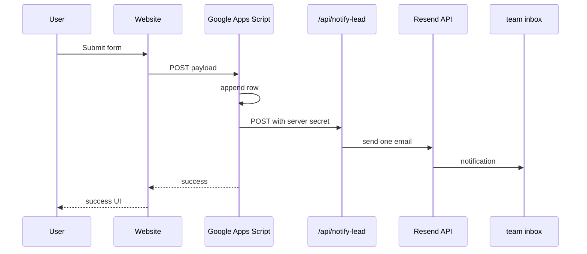

# Lead email notifications

One email after a form row is stored in Google Sheets. The browser does not send email and does not hold the Resend key or the notify secret.

## Flow

Sheet success does not depend on email. If the notify call fails, the row stays and the visitor still sees success.

Data-rights requests are stored in `Data_Rights_Requests` and are not emailed.

## Where credentials live

| Place | Names | Role |
|---|---|---|
| Vercel environment | `RESEND_API_KEY`, `LEAD_NOTIFICATION_FROM`, `LEAD_NOTIFICATION_TO`, `LEAD_NOTIFY_SECRET`, optional `LEAD_NOTIFICATION_TO_CAREERS` | Server sends the email |
| Apps Script → Project Settings → Script properties | `LEAD_NOTIFY_SECRET`, optional `LEAD_NOTIFY_URL` | Script calls the notify API after `appendRow` |

`LEAD_NOTIFY_SECRET` must be the same in both places. Do not add a `VITE_` copy of that secret or of `RESEND_API_KEY`.

`LEAD_NOTIFY_URL` overrides the notify endpoint. When it is empty, the script uses `https://www.ifranchise.in/api/notify-lead`.

## Recipients

- Career applications use `LEAD_NOTIFICATION_TO_CAREERS`, or `hr@ifranchise.in` when that variable is empty.
- Every other emailed form uses `LEAD_NOTIFICATION_TO` (`contact@ifranchise.in`).
- `LEAD_NOTIFICATION_FROM` is `contact@ifranchise.in`. Resend must already have verified that sender. The app passes the address through as a plain email.

## When email stays off

A saved row is never removed because email failed. Logs use a stage name and do not include the API key, the notify secret, or the lead.

| Stage | Where it appears | Meaning |
|---|---|---|
| `missing_script_secret` | Apps Script execution | `LEAD_NOTIFY_SECRET` is not in Script Properties. The notify URL defaults to `https://www.ifranchise.in/api/notify-lead` when that property is empty. |
| `apps_script_external_request_not_authorized` | Apps Script execution | The published script was not reauthorized for outbound requests. |
| `missing_notify_secret` | API HTTP 503 | Vercel has no `LEAD_NOTIFY_SECRET`. |
| `auth_failed` | API HTTP 401 | The Script Property secret and the Vercel secret differ. |
| `missing_email_config` | API HTTP 502 | Vercel is missing `RESEND_API_KEY`, `LEAD_NOTIFICATION_TO`, or `LEAD_NOTIFICATION_FROM`. |
| `resend_rejected` | API HTTP 502 | Resend refused the send. The log includes the provider status only. |
| `accepted_by_resend` | API HTTP 200 | Resend accepted the send. This is not proof the inbox received it. |

Data-rights requests log `data_rights_request` and are not emailed.

## Duplicates

- The browser submits the form once. A double-click is guarded before the request is sent.
- Apps Script calls the notify API once, after that row is appended, and does not retry.
- Resend receives an idempotency key from the form type, submission time, source page, email, and phone. A retry of the same submission does not send a second message.
- A second genuine submission is a new row and a new email.

## Deploy

1. Set the Vercel variables, then redeploy the site so `api/notify-lead.js` is live.
2. Paste the updated `google-apps-script-backend.js` into the existing Apps Script project. Approve the external-request permission when Apps Script asks. That permission is what lets the script call the notify API.
3. Set Script Property `LEAD_NOTIFY_SECRET` to the same value as Vercel. Set `LEAD_NOTIFY_URL` only if the endpoint is not `https://www.ifranchise.in/api/notify-lead`. Do not create a new Web App deployment.
4. Publish **Deploy → Manage deployments → Edit → New version → Deploy**, keeping the same `/exec` URL. Leave “Execute as” and “Who has access” unchanged.
5. Submit one real form and confirm one new sheet row and one inbox message.

`npm run dev` does not serve `/api/notify-lead`.
