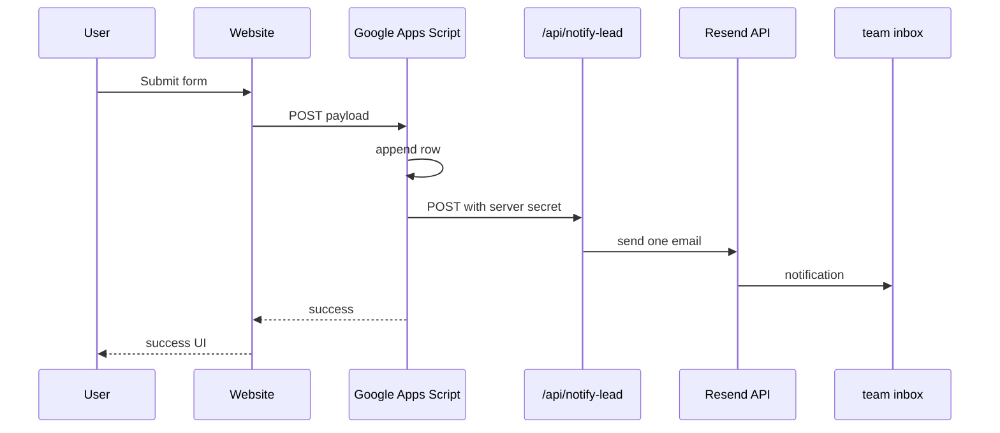

# Lead email notifications

One email after a form row is stored in Google Sheets. The browser does not send email and does not hold the Resend key or the notify secret.

## Flow

Sheet success does not depend on email. If the notify call fails, the row stays and the visitor still sees success.

Data-rights requests are stored in `Data_Rights_Requests` and are not emailed.

## Where credentials live

| Place | Names | Role |
|---|---|---|
| Vercel environment | `RESEND_API_KEY`, `LEAD_NOTIFICATION_FROM`, `LEAD_NOTIFICATION_TO`, `LEAD_NOTIFY_SECRET`, optional `LEAD_NOTIFICATION_TO_CAREERS` | Server sends the email |
| Apps Script → Project Settings → Script properties | `LEAD_NOTIFY_URL`, `LEAD_NOTIFY_SECRET` | Script calls the notify API after `appendRow` |

`LEAD_NOTIFY_SECRET` must be the same in both places. Do not create a `VITE_` copy. `VITE_LEAD_NOTIFY_ENABLED`, `VITE_LEAD_NOTIFY_SECRET`, and `VITE_LEAD_NOTIFY_URL` stay empty.

`LEAD_NOTIFY_URL` is the deployed notify endpoint, for example `https://www.ifranchise.in/api/notify-lead`.

## Recipients

- Career applications use `LEAD_NOTIFICATION_TO_CAREERS`, or `hr@ifranchise.in` when that variable is empty.
- Every other emailed form uses `LEAD_NOTIFICATION_TO`.
- `LEAD_NOTIFICATION_FROM` must be a sender verified in Resend.

## When email stays off

Email is skipped when either Script Property is missing. The API returns 503 when `LEAD_NOTIFY_SECRET` is missing, and 502 when Resend settings are missing. Neither case removes the sheet row.

## Duplicates

- The browser submits the form once. A double-click is guarded before the request is sent.
- Apps Script calls the notify API once, after that row is appended, and does not retry.
- Resend receives an idempotency key from the form type, submission time, source page, email, and phone. A retry of the same submission does not send a second message.
- A second genuine submission is a new row and a new email.

## Deploy

1. Set the Vercel variables, then redeploy the site so `api/notify-lead.js` is live.
2. Paste the updated `google-apps-script-backend.js` into the existing Apps Script project.
3. Add the two Script Properties. Do not create a new Web App deployment.
4. Publish **Deploy → Manage deployments → Edit → New version → Deploy**, keeping the same `/exec` URL.
5. Submit one real form and confirm one new sheet row and one inbox message.

`npm run dev` does not serve `/api/notify-lead`.
